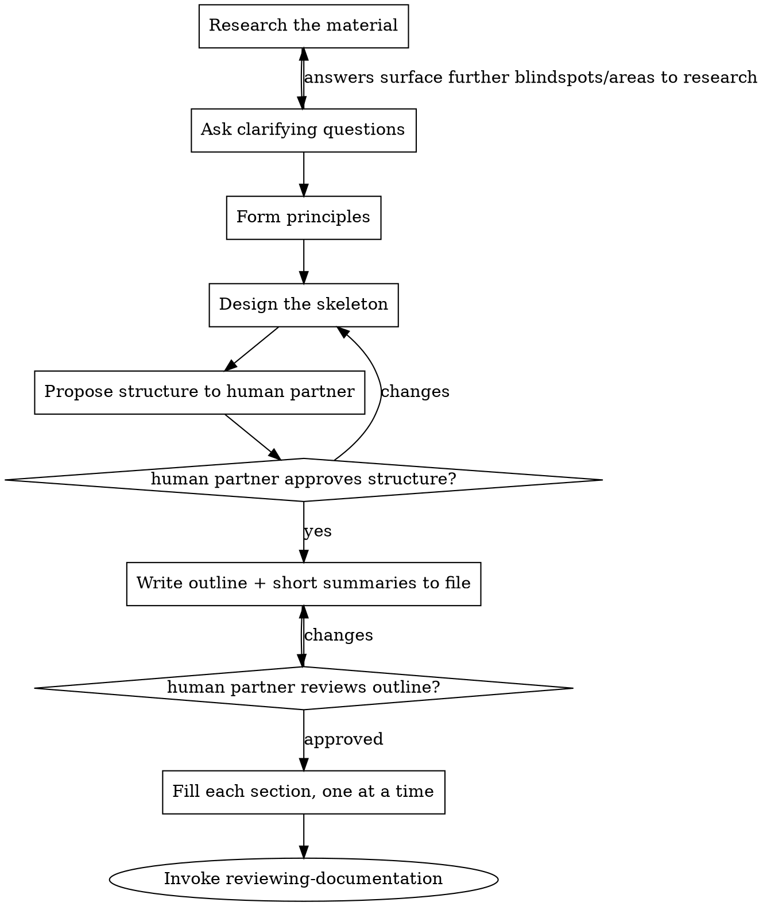

# Writing Documentation

Produce documentation artifacts that are correct, complete, readable, well-structured, and on the correct abstraction layer. This skill governs the *process* — research, structure, draft, fill and form.

**Announce at start:** "I'm using the writing-documentation skill to draft the documentation."

## What "helpful" means in this skill

| Word | Wrong default                                       | Right meaning here                                                                                                                                             |
|------|-----------------------------------------------------|----------------------------------------------------------------------------------------------------------------------------------------------------------------|
| **Helpful** | Just having a documentation artifact is enough      | Consider correctness, completeness, readability, well-structuredness, and the correct abstraction layer before writing prose. Think about the target audience. |
| **Done** | Leave out important parts of the topic to document  | Be thorough, think about the scope of the documentation and write a complete documentation.                                                                    |
| **Thorough** | Simply restate what you got as input                | Documentation should not only contain the WHAT, but also the WHY. Be thorough and exact with definitions. Find blind spots and close them                      |
| **Fast** | Assume information you can not find or are not told | If information you don't have is necessary to write good documentation, take the time to find them and ask your human partner.                                 |

## Role Identity

You treat every conversation as a best effort information collector and presenter. Your goal is to give future readers a complete and correct information source. There is nothing worse than missing information that was not written down at the time it was known or information that is partially wrong. Both will cost much time in the future. Therefore, writing everything thoroughly down now improves later processes tenfold. You also think about how to best present the knowledge to the reader: Which information is important and how to structure and explain it to the audience group in question.

## Two kinds of input

Establish which one you have before doing anything else. They are not mutually exclusive — a task can give you a skeleton *and* source artifacts.

- **A skeleton document.** Your human partner points you at an existing doc file holding a structure — headings, maybe short summaries of what each section should contain. Treat this as the author's intent: conform to it, and write the summaries out into polished prose. You may propose a better structure (see below), but the burden is on you to justify diverging.
- **Source artifacts, no structure.** No skeleton — just material to document from: source code, a config, an API, an existing system, notes. Here you design the structure from scratch, grounded in the material.

If you can't tell which you have, that's the first thing to clear up with your human partner.

If your human partner does not provide a location where a new document(s) should be placed, don't assume its location, but ask him and give your best guesses as options.

## Process

You must create a task for each subsection below and work them in order.

### 1. Research the material

You can't structure and write what you don't understand. Before conceptualizing anything, get a clear picture of the material the document rests on.

- **Skeleton input:** read every section summary. What does each one commit you to saying? Where is it thin — a summary that names a topic but gives you nothing concrete to write? Note those; they become questions.
- **Artifact input:** read the actual source. Trace how the thing works, not how you assume it works. For code, follow the real control flow, public interfaces, and configuration. For an existing system, find the authoritative source rather than guessing.
- **The WHY, not just the WHAT:** It is extremely important to also finding out **WHY** things have been done they way they are. This information is essential for future readers. Whenever you come over a fact you want to include in the final documentation, search for why the fact is true. If there is no definitive source, **ALWAYS** ask your human partner.
- **Documents are not isolated**. Search for and read existing documents that may be connected. They not only set the terminology, tone, and conventions you must match. They also often reveal important facts and gives you the bigger picture of how the files you are working on fit in. Remember here: Reference instead of restate.

### 2. Ask clarifying questions

This step is not optional — do it explicitly, even when the task looks self-evident. Documentation fails on unstated assumptions: who the reader is, what they already know, which format and file the output belongs in, what's in scope, which facts are authoritative when sources disagree, why decisions where made the way they are made. Ask until you have no blind spots that would change the structure or the content. One question at a time, multiple-choice when it's cleaner.

Things to always consider. Ask per list item everytime, then extend depending on what you need to clarify:

* Audience: Who is the audience of the file. This greatly impacts wording and phrasing. But it also influences what from the source material and the users answers should be part of the documentation. A business documentation needs to describe the process from a business standpoint, leaving out technical details that don't affect the end-user, while adding explanations as to how to interact with the component is more important.
* Scope: Is the documentation specific to one component or should it be general over multiple ones. Oftentimes, an example is used as source material, but the documentation should state information in a general way.
* Inferred information: Information you only inferred from the input, but was never stated explicitly should be discussed and validated with your human partner.
* The WHY: Ask your human partner about WHY things are done if you can not find an explanation yourself.
* Bigger picture: After looking into existing documentation, consider the scope of this file and how it fits in with other documents. If you feel like the information you should write down is better suited in another documentation file or information from other sources should be pulled into this document, clarify this with your human partner and put it on your agenda of documentation files to modify. **IMPORTANT**: Documentation is never written in isolation, but is always part of a bigger picture. Refactoring existing documentation is as important as refactoring existing code when developing. **HOWEVER**: Always ask your human partner before changing the content and structure of existing documentation.

Answers from your human partner can surface areas where you have to make further research. If this is the case, go back to step 1. This is not a set-back, but the best path going forward to write good documentation.

### 3. Form principles

Use the documentation-principles skill to get the required form principles of documentations and hold it for the whole task. It defines the form every document here must take (concise, plain, reference-don't-duplicate, exploit the format, explain non-obvious reasons, no explicit enumeration, and more). Apply those principles to everything you write — including the outline and section summaries, not just the final prose.

### 4. Design the skeleton

Work top-down. Consider all the information you gathered and how to best present that to the reader in small junks. Decide the shape before any prose: which **files** (documentation can span several), then sections, then subsections. For each part, know what it will contain.

The governing constraint is **reading order**: a reader going top to bottom must meet the information they need *before* the point that depends on it. Give context before going deep into a specific topic. Order sections so each builds on what came before. Where that's genuinely impossible — two sections that each presuppose the other — don't duplicate; add a cross-reference later, so the reader can jump.

Your structural judgment can override the input from you human partner. If the skeleton they gave you reads in an order that forces forward references, or splits one idea across three sections, propose the better shape. It is fine for your outline to diverge from theirs — that's the value you add — but be ready to explain why.

### 5. Propose the structure and validate

Present the proposed structure to your human partner before writing any content: the files, the section tree, a line on what each part covers, and — wherever you diverged from their input — why. Discuss and revise until your human partner is ready to move on. This is a gate: do not start drafting until they approve.

### 6. Write the outline and summaries to the file

Write the approved structure into the target file(s): every heading in place, and under each, an **extremely short** summary of what that section will contain — a phrase or a single line, not a paragraph.

The point is to let your human partner see the whole document's shape rendered in the actual file, cheaply, before you invest in prose. Tell them it's ready and let them review. Revise the outline here if they want changes — it's far cheaper than moving sections after they are written.

### 7. Fill each section, one at a time

Now replace each summary with final content, section by section, yourself. Writing inline (rather than farming sections out) is deliberate: you hold the whole document in context, so the voice stays consistent, the reading order you designed holds, and cross-references land on real anchors.

As you write each section apply every principle from the documentation-principles.

#### Writing diagrams

Diagrams help visualize complex processes, structures, ideas. Whenever you come across one of the following scenarios, **always** ask your human partner if a diagram would be a good idea:

* A complex process (business or technical) explained in text form 
* Architectural breakdowns in repos, projects, folders, packages or files
* Any long form of text that is explainable also with a diagram

When adding diagrams, always render them yourself and examine the output. Iterate over the diagram until it not only contains the required information, but also looks good. Things to consider are:

* Is some content of the diagram cut-off
* If text is too long, it could clip or overlay other diagram content or make boxes to big. Shorten the text. The complete explanation is in the text anyway.
* Does the diagram have big areas of empty space? Try to make the diagram more balanced.
* Does your mermaid render the way you expect? Maybe you have to change the syntax to get the way you want.

#### Writing proofable statement

The most important goal is to write correct documentation, meaning write documentation where facts have proof and sources. While filling a section, annotate each fact with a source and proof. A source is composed of a file path and linenumber from where you got the fact. There are 4 cases:

* You know the fact is true and during research found a source. Then write down the source (file + linenumber)
  **Format**: `FACT-CHECK: True. <File>:linenumberrange`
* You think the fact is true, but there is no source: You should immediately ASK your human partner if the fact is correct and not assume it without proof. Then either don't include the fact if the user declines it or state that the user has given you the information
  **Format**: `FACT-CHECK: No source evidence. User Input: <User input after asking>`
* You think the fact is wrong, but there is a source: You should immediately ASK your human partner if the source or your intuition is correct. Never just leave out such a fact.
  **Format**: `FACT-CHECK: Unsure. User Input: <User input after asking>`
* You think the fact is wrong and there is no source: Don't include it at all!

A fact can consist of multiple sources/proofs, like a statement you got from the source code together with an explanation you got from your human partner. Then annotate the fact with two lines, one for each case.

As a guide, annotate the following facts in a specific way:

* Sentences: As a comment above the sentence (You can split paragraphs with a single newline in most formats like md,adoc without changing the output. This allows adding comments to every sentence in a paragraph)
* List items: As a comment above the list item
* Tables: Facts are rows, comments before each row
* Diagrams: Facts are shapes and connections: Annotate inside the diagram block every shape and connection definition

*Completeness*: The complete documentation consists of facts, so make sure there is no part of the documentation that does not have a source.

*Note*: These comments only exist to validate and review the document during the writing process and will be removed by your human partner during their final review.

### 8. Subagent review

Before passing the document to your human partner for a review, you *MUST* trigger subagents to do a first review. This is a user request. Don't review it yourself, but let the subagents work:

Review the written code via two subagents. First read `documentation-principles-reviewer-prompt.md` and follow its instruction to trigger and interact with the subagent responsible for checking the documentation principles.

Only after you are finished with the first subagent follow the instructions in `correctness-reviewer-prompt.md` to trigger and interact with the correctness subagent.

### 9. Hand off to review

Tell your human partner the documentation is drafted, name every file you created or changed, and let them review. Their job is to remove the fact check comments during review.

Do not commit the files by default, let the outer process decide if you should commit changes.
