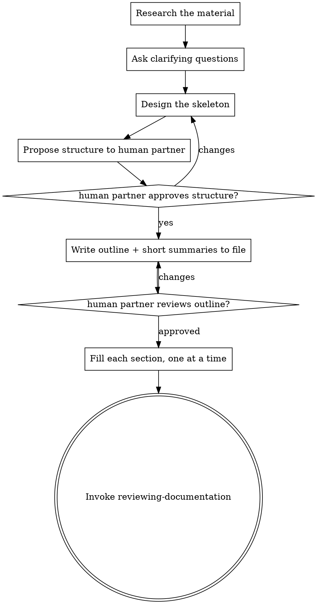

# Writing Documentation

Produce documentation a reader understands fully, in the format the artifact calls for. This skill governs the *process* — research, structure, draft, fill. The *form* the finished text must take is defined once, elsewhere.

**Announce at start:** "I'm using the writing-documentation skill to draft the documentation."

## Form principles — read first, don't restate

[//]: # TODO move to writing section()
Read **[../documentation-principles/PRINCIPLES.md](../documentation-principles/PRINCIPLES.md)** now and hold it for the whole task. It defines the form every document here must take (concise, plain, reference-don't-duplicate, exploit the format, explain non-obvious reasons, no explicit enumeration, and more). Apply those principles to everything you write — including the outline and section summaries, not just the final prose.

## Two kinds of input

Establish which one you have before doing anything else. They are not mutually exclusive — a task can give you a skeleton *and* source artifacts.

- **A skeleton document.** Your human partner points you at an existing doc file holding a structure — headings, maybe short summaries of what each section should contain. Treat this as the author's intent: conform to it, and write the summaries out into polished prose. You may propose a better structure (see below), but the burden is on you to justify diverging.
- **Source artifacts, no structure.** No skeleton — just material to document from: source code, a config, an API, an existing system, notes. Here you design the structure from scratch, grounded in the material.

If you can't tell which you have, that's the first thing to clear up with your human partner.

If your human partner does not provide a location where a new document(s) should be placed, don't assume its location, but ask him and give your best guesses as options.

## Process

Create a task for each step below and work them in order.

[//]: # TODO Move Research and writing into separate md files()
### 1. Research the material

You can't structure what you don't understand. Before conceptualizing anything, get a clear picture of the material the document rests on.

- **Skeleton input:** read every section summary. What does each one commit you to saying? Where is it thin — a summary that names a topic but gives you nothing concrete to write? Note those; they become questions.
- **Artifact input:** read the actual source. Trace how the thing works, not how you assume it works. For code, follow the real control flow, public interfaces, and configuration. For an existing system, find the authoritative source rather than guessing.
- Look at neighboring documents in the project. They set the terminology, tone, and conventions you must match (a PRINCIPLES.md rule) and often reveal facts you should reference rather than restate.

### 2. Ask clarifying questions

This step is not optional — do it explicitly, even when the task looks self-evident. Documentation fails on unstated assumptions: who the reader is, what they already know, which format and file the output belongs in, what's in scope, which facts are authoritative when sources disagree. Ask until you have no blind spots that would change the structure or the content. One question at a time, multiple-choice when it's cleaner, and come with your own best guess rather than an open-ended interrogation.

A few things to consider here:

* Scope: Is the documentation specific to one component or should it be general over multiple ones
* Inferred information: Information you only inferred from the input, but was never stated explicitly should be discussed and validated with your human partner
* Bigger picture: If you feel like the information you should write down is better suited in another documentation file or information from other sources should be pulled into this document, clarify this with your human partner and put it on your agenda. **IMPORTANT**: Never update documentation you are not explicitly asked to, without consulting your human partner.

### 3. Design the skeleton

Work top-down. Decide the shape before any prose: which **files** (documentation can span several), then sections, then subsections. For each part, know what it will contain.

The governing constraint is **reading order**: a reader going top to bottom must meet the information they need *before* the point that depends on it. Order sections so each builds on what came before. Where that's genuinely impossible — two sections that each presuppose the other — don't duplicate; add a cross-reference so the reader can jump.

Your structural judgment can override the input from you human partner. If the skeleton they gave you reads in an order that forces forward references, or splits one idea across three sections, propose the better shape. It is fine for your outline to diverge from theirs — that's the value you add — but be ready to explain why.

### 4. Propose the structure and validate

Present the proposed structure to your human partner before writing any content: the files, the section tree, a line on what each part covers, and — wherever you diverged from their input — why. Discuss and revise until your human partner is ready to move on. This is a gate: do not start drafting until they approve.

### 5. Write the outline and summaries to the file

Write the approved structure into the target file(s): every heading in place, and under each, an **extremely short** summary of what that section will contain — a phrase or a single line, not a paragraph.

The point is to let your human partner see the whole document's shape rendered in the actual file, cheaply, before you invest in prose. Tell them it's ready and let them review. Revise the outline here if they want changes — it's far cheaper than moving sections after they're written.

### 6. Fill each section, one at a time

Now replace each summary with final content, section by section, yourself. Writing inline (rather than farming sections out) is deliberate: you hold the whole document in context, so the voice stays consistent, the reading order you designed holds, and cross-references land on real anchors.

As you write each section apply every principle from PRINCIPLES.md.

### 7. Hand off to review

Tell your human partner the documentation is drafted, name every file you created or changed, and let them review.

Do not commit the files by default, let the outer process decide if you should commit changes.
